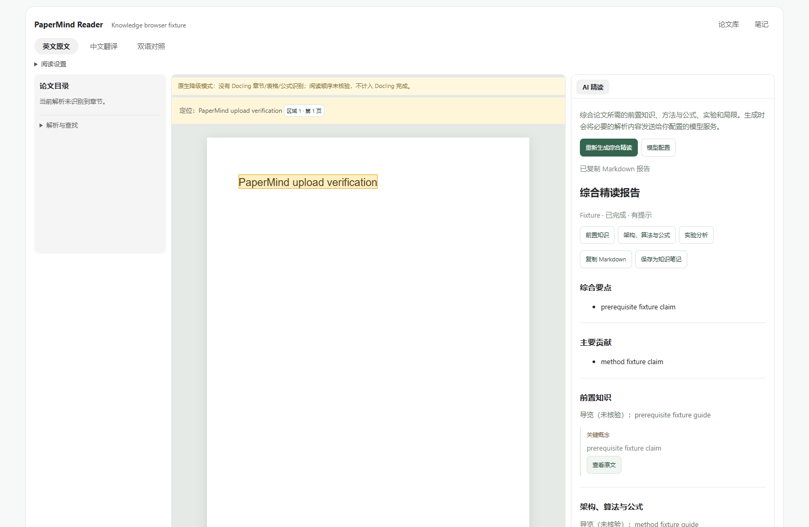

# PaperMind

PaperMind 是面向研究者的 Windows 本地论文工作台。你可以导入论文、阅读 PDF、定位引用，在配置自己的模型服务后做综合精读和学术翻译，并将笔记保存为 Markdown 或发布到 Obsidian。

**当前定位：Windows 预览版。** 应用运行在自己的电脑上，网页默认只监听本机。综合精读和翻译的质量取决于论文解析结果与所选模型，关键结论请对照原文。



## 首次上手

1. 从 [GitHub Releases](https://github.com/wz123719/PaperMind-Open/releases) 下载版本源码 ZIP 并解压；也可以克隆仓库。
2. 安装 Python 3.12、Node.js 24 和 pnpm 11.25.0。已有 Node.js 时可用 `npm install --global pnpm@11.25.0` 安装 pnpm。
3. 在解压后的项目根目录打开 PowerShell，执行：

   ```powershell
   .\setup.ps1
   .\start.ps1
   ```

   首次安装需要联网。`setup.ps1` 默认自动下载并安装 Docling、PyTorch 和其余依赖，下载可能较久。只需要基础阅读时可改用 `.\setup.ps1 -CoreOnly`。启动后打开 [http://127.0.0.1:5173/](http://127.0.0.1:5173/)。使用期间保留启动窗口；按 Ctrl+C 可停止服务。
4. 上传一篇带文字层的 PDF。进入论文，展开「解析与查找」，选择 **原生降级（能力有限）**，点击「启动解析」。基础阅读和原文定位无需模型 API 密钥，也无需下载解析模型。

## 按需启用其他功能

| 功能 | 需要做什么 |
| --- | --- |
| 章节、表格结构解析 | 默认安装已包含 Docling 和 PyTorch。首次使用结构解析前，再运行 `.\.venv\Scripts\python.exe setup-models.py` 下载模型权重。然后在界面选择「Docling 结构解析」。尚未安装公式增强时，先取消该选项。 |
| 公式增强 | 额外运行 `.\.venv\Scripts\python.exe setup-math.py`；`setup-mineru-math.py` 是可选的数学识别备选。模型不会随源码 ZIP 分发。 |
| 综合精读 / AI 翻译 | 新安装默认使用 DeepSeek Flash，端点、模型名和凭据变量名已预设。打开安装生成的 `.env`，将自己的 DeepSeek API 密钥填在 `PAPERMIND_MODEL_API_KEY=` 后，重启 `.\start.ps1` 即可。旧目录没有 `.env` 时，可从 `.env.example` 复制。想换服务时再打开界面的「模型配置」。 |
| 知识笔记 | 在综合报告点「保存为知识笔记」。笔记保存在本地，可复制 Markdown，也可在笔记工作台编辑。 |
| Obsidian | 可选。到「知识笔记 → Vault 设置」填写自己的库文件夹，审核笔记后预览并确认发布。文件名默认取论文标题，同名会加编号。 |

PDF、数据库、笔记和解析缓存默认保存在项目的 `storage/`。使用外部模型执行精读或翻译时，所需论文片段会发送给该服务，可能产生费用。分享项目时无需分享 `.env`、本地数据库或论文文件。应用面向本机单用户使用，请保持默认监听地址。

## 启动和排错

- 页面打不开：确认启动窗口仍在运行；启动器会显示日志位置。`.\start.ps1 -NoBrowser` 只启动服务，由你手动打开网页。
- 端口被占用：停止前一次启动，或用 `.\start.ps1 -WebPort 5180 -ApiPort 8766` 并打开脚本打印的新地址。
- 任务一直等待：检查启动器的 Worker 日志。如果手动启动，API、Worker 和前端缺一不可。调试时可分别运行 `start-api.ps1`、`start-worker.ps1`（或 `start-model-worker.ps1`）和 `start-frontend.ps1`。
- 模型下载中断：Docling 可尝试 `.\.venv\Scripts\python.exe setup-models-resumable.py`；下载完成前可继续使用原生模式。
- 更新旧安装：先停止服务，备份旧安装的 `storage/` 和自己的 `.env`，再更新源码和依赖。首次启动会迁移数据库；不需要把数据库提交到 Git。

## 开发和反馈

- 后端测试：`.\.venv\Scripts\python.exe -m pytest -q`
- 前端验证：在 `frontend/` 中运行 `pnpm run build`
- 启动验证：`.\start.ps1 -CheckOnly` 会检查前端、API 和代理，随后关闭本次启动的服务。
- [提交问题](https://github.com/wz123719/PaperMind-Open/issues)时，请附版本、Windows / Python / Node 版本、复现步骤和相关日志片段。不要贴 API 密钥、私人论文内容或完整数据库。

内部设计与验证可参见[结构解析](STRUCTURE-CONTRACT-R4.md)、[综合精读](ACCEPTANCE-KNOWLEDGE-READING.md)、[翻译](TRANSLATION-CONTRACT.md)和[笔记](NOTES-CONTRACT-R1.md)。安装与使用反馈优先覆盖 Windows；其他平台目前未作为发布支持范围。

PaperMind 源码采用 [GNU AGPL-3.0](LICENSE)。第三方依赖与模型见[第三方组件说明](THIRD_PARTY.md)，参与项目见[贡献指南](CONTRIBUTING.md)。
