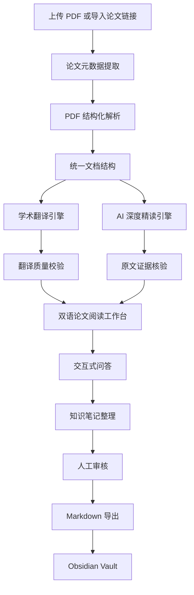
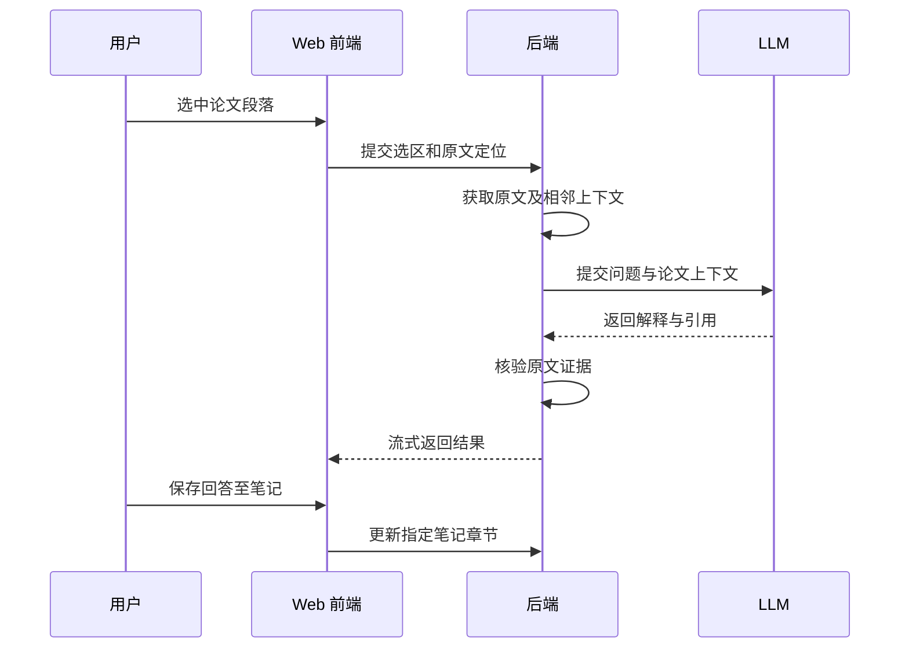
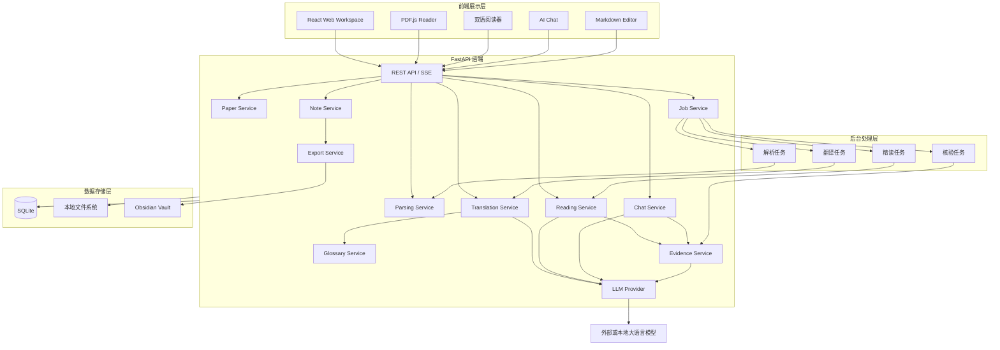
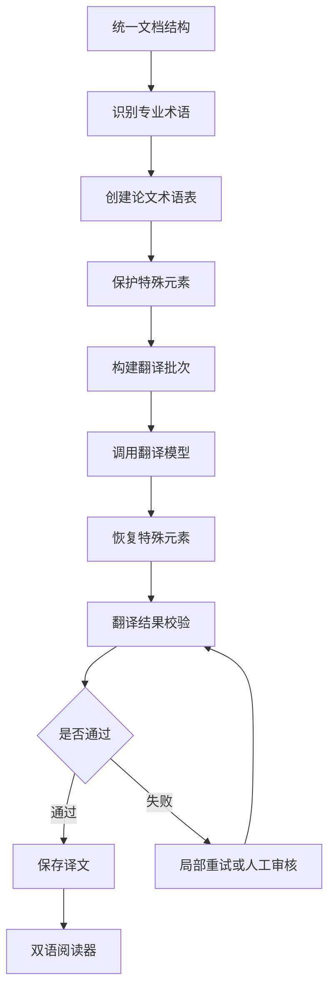
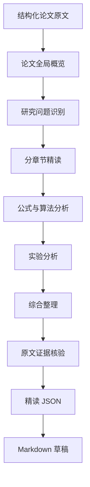
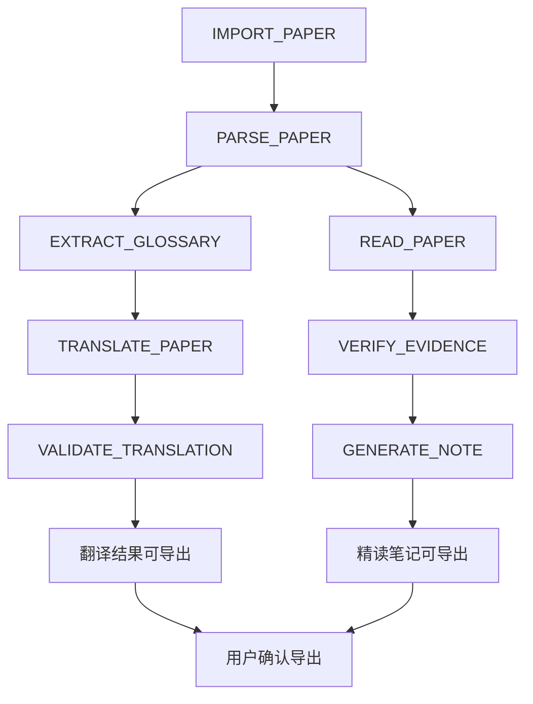
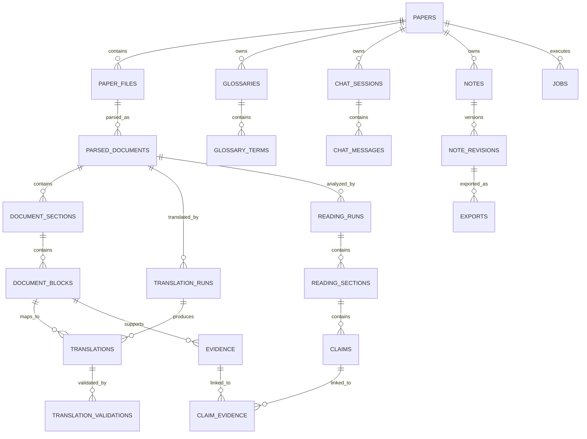

# PaperMind Workspace V1.0 开发方案

## 1. 项目概述

### 1.1 项目背景

在科研学习和技术研究过程中，需要频繁阅读来自 arXiv、IEEE 等学术平台的论文。传统的论文阅读方式存在以下问题：

- 英文论文存在语言理解障碍。
- 专业术语、数学公式与复杂算法难以理解。
- AI 对话与论文原文缺少有效关联。
- 论文阅读过程中产生的知识难以系统保存。
- 已有论文笔记缺少统一的组织与复习机制。
- 从论文阅读到知识管理的工作流程较为分散。

因此，本项目计划构建一个以大语言模型为核心、以学术论文为信息来源、以 Obsidian 为知识存储载体的独立 Web 工作台。

### 1.2 项目长期目标

构建一个集信息获取、学术翻译、深度理解、知识关联和科研辅助于一体的个人智能科研工作台。

### 1.3 版本规划

| 版本 | 产品定位 | 核心目标 |
| --- | --- | --- |
| V1.0 | AI 论文精读工作台 | 完成单篇论文的翻译、理解与知识保存 |
| V2.0 | 个人科研知识管理系统 | 实现多源论文搜集、跨论文知识关联与复用 |
| V3.0 | 智能科研助手 | 实现主动信息获取、专题研究与知识发现 |

三个版本的演进关系：

- V1：让读过的论文真正被理解。
- V2：让理解过的知识真正被连接。
- V3：让积累起来的知识真正服务于研究。

---

## 2. V1.0 核心目标

### 2.1 产品目标

构建一个独立 Web 工作台，实现从原始论文到个人知识笔记的完整处理闭环。

用户能够在工作台中完成：

1. 导入学术论文。
2. 阅读原始 PDF。
3. 获取高质量中文翻译。
4. 进行中英文对照阅读。
5. 使用 AI 对论文进行深度精读。
6. 针对论文段落、公式和图表进行交互式问答。
7. 核验 AI 输出对应的原文证据。
8. 整理和编辑个人知识笔记。
9. 将论文翻译及精读结果保存至 Obsidian。

### 2.2 三大核心能力

#### 学术翻译

解决论文阅读中的语言障碍，实现忠实、完整、专业且术语一致的全文翻译。

#### AI 深度精读

解决论文阅读中的知识理解障碍，对研究背景、理论机制、数学公式、算法流程和实验结果进行深入分析。

#### 知识沉淀

将翻译结果、AI 精读结果以及用户个人理解转化为可长期保存、检索和复习的 Markdown 知识笔记。

### 2.3 V1 完整工作流程



### 2.4 核心设计原则

- 原始 PDF 是论文内容的主要证据来源。
- 翻译与精读相互独立，可以并行执行。
- AI 精读默认以英文原文为依据，而非仅依赖中文译文。
- 所有重要论文事实应具备可追溯的原文引用。
- 翻译结果与原文通过稳定的文档块 ID 建立关联。
- AI 输出不能直接覆盖用户手动编辑的内容。
- 所有长期知识应采用开放的 Markdown 格式保存。
- 优先保证单篇论文的处理质量，而不是追求复杂的自动化能力。

---

## 3. V1 功能范围

### 3.1 功能优先级

优先级定义：

- P0：V1 必须实现的核心功能。
- P1：核心闭环稳定后完善的功能。
- P2：可延后至后续版本的功能。

| 功能模块 | 具体功能 | 优先级 |
| --- | --- | --- |
| 论文获取 | 本地 PDF 上传 | P0 |
| 论文获取 | arXiv 链接导入 | P0 |
| 论文获取 | 论文元数据提取 | P0 |
| 论文获取 | DOI 元数据补全 | P1 |
| 论文获取 | IEEE 全文自动获取 | P2 |
| 文档解析 | 章节与正文解析 | P0 |
| 文档解析 | 原文页面定位 | P0 |
| 文档解析 | 公式与表格内容保留 | P0 |
| 文档解析 | 图片提取 | P0 |
| 文档解析 | 复杂公式专项识别 | P1 |
| 学术翻译 | 全文英译中 | P0 |
| 学术翻译 | 章节独立翻译 | P0 |
| 学术翻译 | 段落独立翻译 | P0 |
| 学术翻译 | 中英文段落对齐 | P0 |
| 学术翻译 | 专业术语统一 | P0 |
| 学术翻译 | 数学公式保护 | P0 |
| 学术翻译 | 翻译结果缓存 | P0 |
| 学术翻译 | 单段重新翻译 | P0 |
| 学术翻译 | 图表标题翻译 | P0 |
| 学术翻译 | 自定义术语表 | P1 |
| 学术翻译 | 双语 PDF 排版导出 | P2 |
| 论文阅读 | 原始 PDF 阅读 | P0 |
| 论文阅读 | 中文翻译阅读 | P0 |
| 论文阅读 | 中英文对照阅读 | P0 |
| 论文阅读 | 章节导航 | P0 |
| 论文阅读 | 原文跳转与高亮 | P0 |
| AI 精读 | 全文结构化精读 | P0 |
| AI 精读 | 分章节精读 | P0 |
| AI 精读 | 核心公式解释 | P0 |
| AI 精读 | 算法与架构解释 | P0 |
| AI 精读 | 实验结果分析 | P0 |
| AI 精读 | 原文证据核验 | P0 |
| 交互问答 | 多轮对话 | P0 |
| 交互问答 | 原文划选提问 | P0 |
| 交互问答 | 中文译文划选提问 | P0 |
| 交互问答 | 回答保存至笔记 | P0 |
| 交互问答 | 图表选区提问 | P1 |
| 知识保存 | Markdown 生成 | P0 |
| 知识保存 | Markdown 编辑 | P0 |
| 知识保存 | 全文翻译导出 | P0 |
| 知识保存 | 论文精读笔记导出 | P0 |
| 知识保存 | Obsidian Vault 写入 | P0 |
| 知识保存 | 笔记版本管理 | P0 |
| 知识保存 | 文件冲突检测 | P0 |
| 系统管理 | 模型 API 配置 | P0 |
| 系统管理 | 后台任务管理 | P0 |
| 系统管理 | 失败重试 | P0 |
| 系统管理 | Token 与成本统计 | P1 |

### 3.2 V1 暂不实现的功能

- 多源学术论文搜索平台。
- 自动追踪研究方向。
- 自动推荐最新论文。
- 跨论文知识图谱。
- 全局知识库 RAG。
- 自动生成多论文综述。
- Obsidian 自动双向同步。
- 多用户与团队协作。
- 完全自主的科研 Agent。
- 保留原始 PDF 排版的全文双语 PDF 生成。

上述功能主要在 V2 和 V3 中逐步实现。

---

## 4. 前端产品设计

### 4.1 页面结构

V1 包含四个主要页面。

| 页面 | 路由 | 职责 |
| --- | --- | --- |
| 论文库 | /papers | 论文导入、管理、筛选与任务状态 |
| 论文精读工作台 | /papers/:id/read | 翻译阅读、AI 精读、问答与笔记 |
| 知识笔记管理 | /notes | 笔记编辑、审核、历史与导出 |
| 系统设置 | /settings | 模型配置、术语与 Vault 路径管理 |

### 4.2 论文库页面

#### 核心功能

- 上传本地 PDF。
- 输入 arXiv 链接。
- 显示论文标题、作者、发表时间和来源。
- 按论文标题、作者及标签搜索。
- 展示解析、翻译和精读任务状态。
- 查看论文阅读进度。
- 继续未完成的阅读任务。
- 删除或者归档论文。
- 检测重复论文。

#### 论文卡片信息

- 论文标题。
- 作者列表。
- 发表年份。
- 论文来源。
- 研究方向标签。
- 解析状态。
- 翻译进度。
- 精读状态。
- 最近阅读时间。
- 笔记导出状态。

解析、翻译、精读和导出采用独立状态，避免使用一个状态字段描述所有并行任务。

### 4.3 论文精读工作台

论文精读工作台是 V1 的核心页面。

采用三栏式设计：

```text
┌──────────────────────────────────────────────────────────────────┐
│ 返回论文库 | 论文标题 | 原文 / 中文 / 双语 | 任务状态 | 导出笔记 │
├──────────────┬─────────────────────────────┬─────────────────────┤
│ 左侧导航     │ 中央论文阅读区              │ 右侧 AI 工作区      │
│              │                             │                     │
│ Abstract     │ 英文原文                    │ 精读 | 对话 | 笔记  │
│ Introduction │                             │                     │
│ Related Work │ 中文翻译                    │ 核心思想            │
│ Methodology  │                             │ 方法分析            │
│ Experiments  │ 数学公式                    │ 公式解释            │
│ Conclusion   │                             │ 实验分析            │
│              │ 图表与算法                  │ 原文证据            │
│ Figures      │                             │                     │
│ Tables       │                             │ 输入问题...         │
└──────────────┴─────────────────────────────┴─────────────────────┘
```

三个区域均应支持适当的宽度调整与折叠。

#### 左侧：文档导航区域

主要功能：

- 显示论文目录树。
- 显示章节层级。
- 显示公式索引。
- 显示图表索引。
- 显示各章节翻译状态。
- 显示各章节精读状态。
- 点击章节跳转对应阅读位置。

#### 中间：论文阅读区域

提供三种阅读模式。

##### 模式一：英文原文模式

使用 PDF.js 渲染原始 PDF。

支持：

- PDF 页面显示。
- 页面缩放。
- 页面跳转。
- 全文搜索。
- 文字划选。
- 原文证据高亮。
- 图表阅读。

##### 模式二：中文翻译模式

使用结构化文档视图展示翻译后的论文。

支持：

- 按章节阅读。
- 专业术语显示。
- LaTeX 公式渲染。
- 图片与表格显示。
- 图表标题翻译。
- 中文段落划选。
- 单段重新翻译。
- 点击译文跳转英文原文。

##### 模式三：中英文对照模式

默认采用段落级上下对照方式。

示例：

**Original**

We propose a novel memory retrieval architecture.

**Translation**

我们提出了一种新型记忆检索架构。

每个原文块与译文块均通过 source_block_id 建立对应关系。

后续可选支持左右分栏对照。

V1 不要求重建具有原始 PDF 排版的双语 PDF，而是通过结构化文档视图实现双语阅读。

#### 右侧：AI 工作区域

右侧包含三个功能标签页。

##### Tab 1：AI 精读

展示：

- 一句话总结。
- 研究背景。
- 核心创新。
- 理论机制。
- 算法流程。
- 数学公式解释。
- 实验结果分析。
- 局限性。
- 工程复现建议。
- 原文证据。

支持点击证据跳转到对应论文位置。

##### Tab 2：交互式问答

支持：

- 针对整篇论文提问。
- 针对指定章节提问。
- 针对选中英文段落提问。
- 针对选中中文段落提问。
- 多轮上下文对话。
- 流式回答。
- 原文证据引用。
- 将回答保存到指定笔记章节。

##### Tab 3：知识笔记

支持：

- 展示当前 Markdown 草稿。
- 编辑指定章节。
- 插入 AI 对话结果。
- 添加个人理解。
- 添加个人疑问。
- 查看原文引用。
- 保存草稿。
- 查看版本历史。
- 导出至 Obsidian。

### 4.4 文本划选交互

用户选中英文或中文段落后，浮动菜单提供以下操作：

- 翻译选中内容。
- 重新翻译。
- 解释选中内容。
- 详细推导公式。
- 向 AI 提问。
- 查看对应英文原文。
- 添加到知识笔记。

交互过程：



---

## 5. 总体技术架构

### 5.1 架构模式

V1 采用：

- 本地优先架构（Local-first）。
- 前后端分离。
- 模块化单体后端。
- 独立后台 Worker。
- 确定性 LLM Workflow。
- 本地文件系统持久化。

不采用微服务架构，不提前引入复杂的分布式任务系统和 Multi-Agent。

### 5.2 总体架构图



### 5.3 技术选型

| 技术层 | 推荐技术 | 用途 |
| --- | --- | --- |
| 前端框架 | React | Web 应用 |
| 前端语言 | TypeScript | 类型安全 |
| 构建工具 | Vite | 前端开发与构建 |
| UI 样式 | Tailwind CSS | 页面样式 |
| 状态管理 | Zustand | 前端交互状态 |
| 服务端状态 | TanStack Query | API 请求与缓存 |
| PDF 阅读器 | PDF.js | 原始 PDF 渲染 |
| 数学公式 | KaTeX | LaTeX 公式渲染 |
| Markdown 编辑 | CodeMirror | 知识笔记编辑 |
| 后端框架 | FastAPI | REST API |
| 数据校验 | Pydantic | 请求与结构化输出校验 |
| ORM | SQLAlchemy | 数据库访问 |
| 数据库 | SQLite | 论文、任务、笔记及翻译记录 |
| 数据库迁移 | Alembic | 数据结构版本管理 |
| 全文检索 | SQLite FTS5 | 论文内文本检索 |
| PDF 解析 | Docling | 文档结构解析 |
| PDF 辅助处理 | PyMuPDF | 页面与坐标定位 |
| 工作流 | 自定义状态机 | 任务编排 |
| 模型接入 | LLM Provider Adapter | 多模型支持 |
| 流式通信 | SSE | 对话与任务进度 |
| 文件存储 | 本地文件系统 | PDF、JSON、图片及 Markdown |
| 知识管理 | Obsidian | 长期知识保存 |
| 后端测试 | Pytest | 单元及集成测试 |
| 前端测试 | Vitest / Playwright | 组件与端到端测试 |

---

## 6. 后端改造方案

### 6.1 原后端与新版后端对比

原 V1 主要包含：

- Paper Service
- Parsing Service
- Reading Service
- Evidence Service
- Note Service

加入学术翻译和双语阅读后，需要重新划分服务职责。

| 后端服务 | 改造方式 | 改造内容 |
| --- | --- | --- |
| Paper Service | 修改 | 支持多阶段任务与论文版本管理 |
| Parsing Service | 重点修改 | 提供稳定文档块及双语对齐基础 |
| Translation Service | 新增 | 全文及局部学术翻译 |
| Glossary Service | 新增 | 专业术语管理 |
| Translation Validator | 新增 | 译文完整性与一致性检测 |
| Reading Service | 修改 | 独立基于原文执行深度精读 |
| Evidence Service | 修改 | 支持英文与中文选区映射 |
| Chat Service | 新增或独立拆分 | 管理多轮论文问答 |
| Note Service | 修改 | 管理精读笔记及人工修改 |
| Export Service | 新增或独立拆分 | 管理 Markdown 与 Vault 导出 |
| Job Service | 修改 | 并行任务、重试与进度管理 |
| LLM Provider | 修改 | 按翻译、精读、问答配置不同模型 |
| Settings Service | 修改 | 增加翻译及术语相关配置 |

### 6.2 Paper Service

#### 职责

- 论文上传。
- arXiv 链接导入。
- 论文元数据提取。
- 原始 PDF 保存。
- 文件哈希去重。
- 论文版本管理。
- 解析任务关联。
- 翻译任务关联。
- 精读任务关联。
- 论文删除与归档。

#### 关键设计

论文使用稳定的内部 ID。

文件哈希使用 SHA-256。

通过 DOI 和 arXiv ID 识别同一论文的不同版本，但不能直接覆盖旧版本。

原始文件应保持不可变，解析、翻译和精读结果必须关联具体论文文件版本。

IEEE 等非开放获取论文，V1 主要通过用户合法获取的 PDF 上传导入，不假设可以绕过订阅权限自动下载全文。

### 6.3 Parsing Service

#### 职责

- 提取论文标题与作者。
- 识别章节层级。
- 提取正文段落。
- 提取数学公式。
- 提取表格。
- 提取图片及图注。
- 提取参考文献。
- 保留页面坐标。
- 建立统一文档结构。

#### 核心改造

原方案仅面向 AI 精读提供解析结果。

新版 Parsing Service 必须同时服务于：

- 学术翻译。
- 双语阅读。
- AI 精读。
- 交互问答。
- 原文证据核验。
- Markdown 导出。

因此，需要建立统一文档模型 Unified Document Model。

#### 文档块类型

- heading
- paragraph
- equation
- figure
- caption
- table
- code
- algorithm
- reference
- list

#### 文档块数据结构

```json
{
  "block_id": "blk_001",
  "paper_id": "paper_001",
  "document_id": "doc_001",
  "section_id": "section_003",
  "type": "paragraph",
  "content": "The proposed method...",
  "order": 12,
  "source_location": {
    "page_index": 4,
    "page_label": "5",
    "bbox": [72, 120, 510, 180],
    "coordinate_system": "top_left",
    "unit": "pdf_points"
  },
  "metadata": {
    "parser": "docling",
    "parser_version": "configured-version"
  }
}
```

说明：

- page_index 为从 0 开始的物理页面索引。
- page_label 为向用户显示的页面标签。
- bbox 保存原文区域坐标。
- 跨页段落应允许保存多个 source_location。
- 不同解析版本之间应保留独立文档记录。
- 无法精确获得坐标时，允许降级为页面级定位。

### 6.4 Translation Service

Translation Service 是本次后端新增的核心服务。

#### 核心职责

- 全文英译中。
- 分章节翻译。
- 分段落翻译。
- 局部重新翻译。
- 图表标题翻译。
- 术语统一。
- 特殊内容保护。
- 原文与译文对齐。
- 结果缓存。
- 翻译版本管理。
- 翻译任务失败恢复。

#### 翻译工作流程



#### 翻译原则

- 保持学术表达的准确性。
- 不随意增加原文未包含的信息。
- 不将论文翻译改写为总结。
- 保留必要的英文专业术语。
- 保留作者自定义方法名称。
- 保留原文逻辑结构。
- 保留参考文献与交叉引用。
- 保留数学公式和实验数值。

#### 翻译粒度

对用户而言，支持三个处理粒度：

- Full Paper：全文翻译。
- Section：章节翻译。
- Block：段落翻译。

在内部执行时，以多个相邻的结构化文档块作为翻译批次，并提供必要的前后文。

模型必须返回包含原始 block_id 的结构化结果。

禁止直接依靠模型生成的段落顺序确定原文和译文关系。

#### 翻译结果结构

```json
{
  "translation_id": "trans_001",
  "document_id": "doc_001",
  "source_block_id": "blk_001",
  "source_language": "en",
  "target_language": "zh-CN",
  "translated_text": "本文提出了一种新的方法。",
  "model_id": "configured-model",
  "glossary_version": "v1",
  "prompt_version": "v1",
  "status": "completed",
  "validation_status": "passed"
}
```

#### 翻译缓存

缓存键应由以下内容共同确定：

- 原文内容哈希。
- 原文语言。
- 目标语言。
- 模型 ID。
- Prompt 版本。
- 术语表版本。
- 翻译配置版本。

任一关键配置发生变化，应重新判断缓存是否有效。

### 6.5 Glossary Service

#### 职责

- 自动识别论文中的专业术语。
- 识别缩写及其完整名称。
- 保存英文术语与中文译名。
- 保证全文译法一致。
- 支持用户指定术语译法。
- 管理术语表版本。
- 为 V2 跨论文术语库预留扩展接口。

#### 术语列表示例

| 英文术语 | 中文译名 |
| --- | --- |
| Attention Mechanism | 注意力机制 |
| Embedding | 嵌入表示 |
| Contrastive Learning | 对比学习 |
| Latent Space | 潜在空间 |
| Ablation Study | 消融实验 |
| Knowledge Distillation | 知识蒸馏 |
| Reranking | 重排序 |

#### 术语数据结构

```json
{
  "term_id": "term_001",
  "paper_id": "paper_001",
  "source_term": "Contrastive Learning",
  "target_term": "对比学习",
  "definition": "一种通过正负样本学习表示的方法",
  "source": "model_extracted",
  "locked": false
}
```

#### 术语优先级

术语翻译优先级从高到低：

1. 用户锁定的术语。
2. 当前论文明确指定的术语。
3. 已确认的论文术语表。
4. 系统默认术语表。
5. 模型自动生成的译法。

对于没有统一译名的新术语，可以保留英文，并在首次出现时附上解释。

### 6.6 Translation Validator

负责翻译质量检查。

#### 确定性校验

- 检查是否存在漏译文档块。
- 检查 block_id 是否正确。
- 检查数学公式是否完整。
- 检查引用编号是否丢失。
- 检查图表编号是否发生变化。
- 检查实验数值是否被修改。
- 检查术语译法是否一致。
- 检查占位符是否完整恢复。

#### 特殊元素保护示例

翻译前：

```text
The objective function is defined as {{EQ_001}}.
The experimental results are shown in {{FIG_002}}.
```

模型返回：

```text
目标函数定义为 {{EQ_001}}。
实验结果如 {{FIG_002}} 所示。
```

然后由程序恢复原始公式与图表引用。

#### 语义校验

对于重要段落，可以使用独立模型辅助检查：

- 是否忠实表达原文。
- 是否遗漏关键条件。
- 是否错误理解否定关系。
- 是否错误翻译因果关系。
- 是否出现原文不存在的信息。

模型校验结果只作为辅助判断，不代表译文已经经过人工确认。

#### 校验失败处理

- 优先执行局部重试。
- 限制最大重试次数。
- 保存失败原因。
- 保留原文供用户核验。
- 多次失败后标记为 needs_review。

### 6.7 Reading Service

负责 AI 深度精读。

#### 核心改造

Reading Service 不应将中文翻译作为论文事实的唯一输入。

新的处理模式为：

- 英文原文是主要依据。
- 中文译文用于辅助理解与展示。
- 精读结果默认使用中文输出。
- 所有论文事实引用英文原文。
- 翻译任务与精读任务可以并行执行。

#### 精读工作流程



#### 精读内容

1. 论文一句话概括。
2. 研究背景。
3. 研究问题与研究动机。
4. 现有方法的不足。
5. 论文核心贡献。
6. 整体算法框架。
7. 关键模块输入输出。
8. 数学公式与符号解释。
9. 算法推导与执行过程。
10. 实验数据集。
11. 评价指标与基线。
12. 实验结果。
13. 消融实验。
14. 方法的优势与局限。
15. 工程实现与复现建议。
16. 待进一步研究的问题。

#### 输出结构

```json
{
  "reading_id": "reading_001",
  "paper_id": "paper_001",
  "document_id": "doc_001",
  "sections": [
    {
      "section_id": "section_001",
      "title": "核心贡献",
      "claims": [
        {
          "claim_id": "claim_001",
          "content": "作者提出了一种新的记忆检索方法。",
          "claim_type": "author_fact",
          "evidence_ids": ["evidence_001"],
          "verification_status": "supported"
        }
      ]
    }
  ]
}
```

### 6.8 Evidence Service

#### 职责

- 建立 AI 回答与英文原文之间的证据关联。
- 根据中文选区定位英文原文。
- 提供原文页码、章节及区域。
- 检查引用是否真实存在。
- 检查证据是否支持对应结论。
- 支持前端原文高亮。

#### 证据类型

| 类型 | 含义 |
| --- | --- |
| author_fact | 作者明确提出的事实 |
| inference | 基于论文内容进行的推导 |
| background | 外部背景知识 |
| suggestion | AI 提出的工程或研究建议 |

#### 核验状态

| 状态 | 含义 |
| --- | --- |
| supported | 存在支持结论的原文依据 |
| inferred | 基于原文进行的合理推导 |
| unsupported | 当前证据不足 |
| conflicted | 与其他证据存在矛盾 |
| needs_review | 需要人工核验 |

#### 证据结构

```json
{
  "evidence_id": "evidence_001",
  "document_id": "doc_001",
  "source_block_id": "blk_001",
  "quote": "The proposed method...",
  "page_index": 4,
  "page_label": "5",
  "section_id": "section_003",
  "bbox": [72, 120, 510, 180]
}
```

证据校验必须区分：

- 引用位置是否有效。
- 引用内容是否真实存在。
- 引用内容是否支持对应结论。

找到正确页码不代表结论一定正确。

### 6.9 Chat Service

#### 职责

- 创建论文对话会话。
- 管理多轮对话历史。
- 接收英文原文选区。
- 接收中文译文选区。
- 获取相关论文上下文。
- 调用 LLM 生成回答。
- 流式返回模型输出。
- 建立回答与原文证据的关联。
- 将指定回答保存至笔记。

#### 上下文构建策略

局部问题：

- 用户选中块。
- 相邻文档块。
- 所属章节。
- 相关公式或图表。
- 必要的对话历史。

全文问题：

- 论文元数据。
- 全局精读结果。
- 章节路由。
- SQLite FTS5 检索结果。
- 必要时补充相关原文。

#### 中文选区处理


### 6.10 Note Service

#### 职责

- 生成精读笔记草稿。
- 管理 Markdown 内容。
- 管理笔记章节。
- 保存用户个人理解。
- 保存交互式问答结果。
- 管理笔记修改历史。
- 支持局部更新。
- 保存人工审核状态。

#### 更新原则

- AI 生成的内容默认是草稿。
- 用户可以审核、接受或者拒绝修改。
- 允许对指定章节进行独立更新。
- 不自动覆盖用户手动编辑的内容。
- 使用 revision 实现乐观并发控制。
- 每次重要修改保留独立版本。

#### 论文精读笔记模板

1. 论文基本信息。
2. 一句话概括。
3. 核心贡献。
4. 研究背景。
5. 问题定义。
6. 相关工作。
7. 整体框架。
8. 关键技术与公式。
9. 算法流程。
10. 实验设计。
11. 实验结果与分析。
12. 局限性。
13. 工程复现建议。
14. 个人理解。
15. 个人疑问。
16. 原文证据。
17. 关联知识。

### 6.11 Export Service

将生成结果安全保存至 Obsidian。

#### 导出内容

- 原始论文 PDF。
- 完整中文翻译 Markdown。
- AI 深度精读 Markdown。
- 论文图表资源。
- 论文元数据。
- 文件间的 Obsidian 双向链接。

用户可以选择是否导出原始 PDF 和全文译文。

#### 导出目录结构

```text
Obsidian Vault/
└── Papers/
    └── paper_001/
        ├── Paper-A.md
        ├── Paper-A-Translation.md
        ├── Paper-A.pdf
        └── assets/
            ├── figure_001.png
            └── figure_002.png
```

#### 文件职责

| 文件 | 内容 |
| --- | --- |
| Paper-A.md | 论文精读与个人理解 |
| Paper-A-Translation.md | 完整论文翻译 |
| Paper-A.pdf | 原始论文 |
| assets/ | 论文图表资源 |

#### 精读笔记 YAML 示例

```yaml
---
id: paper_001
type: paper
title: Example Paper
authors:
  - Author A
year: 2026
source: arxiv
arxiv_id: null
doi: null
translation_status: completed
reading_status: reviewed
tags:
  - paper
  - ai-agent
aliases:
  - Example Paper
---
```

#### Obsidian 内部链接

- 原始论文：[[Paper-A.pdf]]
- 中文翻译：[[Paper-A-Translation]]
- 精读笔记：[[Paper-A]]
- 相关概念：[[Agent Memory]]

V1 支持同一篇论文相关文件之间的自动链接，以及用户手动添加其他知识笔记链接。

跨论文语义关联推荐留到 V2。

#### 安全导出流程

1. 读取目标 Vault 配置。
2. 验证目标路径是否位于授权目录内。
3. 生成 Markdown 与图片资源。
4. 检查 YAML、公式和链接。
5. 检查目标文件是否发生外部修改。
6. 如存在冲突，暂停导出并提示用户。
7. 写入临时文件。
8. 原子替换单个目标文件。
9. 保存导出清单与文件哈希。
10. 检测多文件导出的部分失败并支持恢复。

V1 采用手动确认的单向发布模式，不实现自动双向同步。

### 6.12 Job Service

#### 职责

- 后台任务创建。
- 任务调度。
- 依赖关系管理。
- 任务进度统计。
- 并发控制。
- 任务取消。
- 失败重试。
- 服务重启后的任务恢复。
- SSE 任务事件推送。

#### 任务类型

```text
IMPORT_PAPER
PARSE_PAPER
EXTRACT_GLOSSARY
TRANSLATE_PAPER
TRANSLATE_SECTION
TRANSLATE_BLOCK
VALIDATE_TRANSLATION
READ_PAPER
READ_SECTION
VERIFY_EVIDENCE
GENERATE_NOTE
EXPORT_NOTE
```

#### 任务状态

```text
pending
running
completed
failed
cancelled
needs_review
```

#### 任务依赖关系



全文翻译失败不应阻止原文阅读和 AI 精读。

精读失败也不应影响已经完成的翻译结果。

如果用户同时导出两个文件，系统需要检查两个任务的实际完成状态。

#### 执行机制

V1 采用：

- SQLite 持久化任务表。
- 独立 Worker 进程。
- 任务租约与心跳。
- 有界重试。
- 幂等任务执行。
- 分章节检查点。
- SSE 进度通知。

后续根据并发需要再考虑 Redis 和 Celery。

### 6.13 LLM Provider

#### 职责

- 统一不同模型提供商的调用方式。
- 支持结构化 JSON 输出。
- 支持流式文本输出。
- 支持多模态输入。
- 记录 Token 使用量。
- 处理模型调用失败。
- 管理超时与速率限制。
- 根据任务类型选择模型。

#### 模型任务路由

| 任务类型 | 模型要求 |
| --- | --- |
| 术语提取 | 结构化输出能力 |
| 学术翻译 | 翻译准确性与术语一致性 |
| 深度精读 | 长上下文与推理能力 |
| 公式解释 | 数学推理能力 |
| 图表解释 | 多模态理解能力 |
| 交互问答 | 响应速度与上下文理解 |
| 证据核验 | 事实判断与结构化输出 |

V1 不强制所有任务使用同一个模型。

#### 抽象接口

```python
from typing import Protocol, Any, AsyncIterator

class LLMProvider(Protocol):

    async def generate(
        self,
        messages: list[dict[str, Any]],
        response_schema: dict | None = None
    ) -> dict:
        ...

    def stream(
        self,
        messages: list[dict[str, Any]]
    ) -> AsyncIterator[str]:
        ...
```

模型配置由后端统一管理，API Key 不应暴露给前端，也不应写入代码仓库。

---

## 7. 数据库设计

### 7.1 数据库技术

V1 使用：

- SQLite
- SQLAlchemy
- Alembic
- SQLite FTS5

数据库主要保存元数据、索引、任务状态及结构化记录。

原始 PDF 和图片等大型文件保存在本地文件系统。

### 7.2 核心数据库表

| 数据表 | 职责 |
| --- | --- |
| papers | 论文基本信息 |
| paper_files | 原始论文文件及版本 |
| parsed_documents | 解析文档版本 |
| document_sections | 论文章节结构 |
| document_blocks | 原文文档块 |
| glossaries | 论文术语表 |
| glossary_terms | 术语记录 |
| translation_runs | 翻译任务记录 |
| translations | 块级翻译结果 |
| translation_validations | 翻译质量校验结果 |
| reading_runs | 精读任务记录 |
| reading_sections | 分章节精读结果 |
| claims | AI 生成的重要结论 |
| evidence | 原文证据 |
| claim_evidence | 结论与证据关联 |
| chat_sessions | 对话会话 |
| chat_messages | 对话消息 |
| notes | 当前知识笔记 |
| note_revisions | 笔记历史版本 |
| exports | 导出记录 |
| jobs | 持久化任务 |
| job_events | 任务事件 |
| model_usage | 模型调用与成本记录 |
| settings | 系统配置 |

### 7.3 新增数据库表重点设计

#### translations

```text
id
translation_run_id
document_id
source_block_id
source_language
target_language
translated_text
model_id
prompt_version
glossary_version
source_hash
status
validation_status
created_at
updated_at
```

#### glossary_terms

```text
id
glossary_id
source_term
target_term
definition
source
locked
created_at
updated_at
```

#### translation_runs

```text
id
paper_id
document_id
glossary_id
target_language
model_id
prompt_version
total_blocks
completed_blocks
failed_blocks
status
created_at
updated_at
```

#### translation_validations

```text
id
translation_id
validator_type
validation_status
issues_json
created_at
```

#### jobs

```text
id
paper_id
job_type
status
progress
payload_json
attempts
max_attempts
lease_until
last_heartbeat_at
error_message
created_at
started_at
finished_at
```

### 7.4 数据关系图



---

## 8. API 接口设计

统一 API 前缀：

```text
/api/v1
```

### 8.1 论文管理接口

| Method | API | 功能 |
| --- | --- | --- |
| POST | /papers/upload | 上传 PDF |
| POST | /papers/import | 导入论文链接 |
| GET | /papers | 查询论文列表 |
| GET | /papers/{id} | 查询论文详情 |
| GET | /papers/{id}/pdf | 获取原始 PDF |
| PATCH | /papers/{id} | 更新论文信息 |
| DELETE | /papers/{id} | 删除或归档论文 |

### 8.2 论文解析接口

| Method | API | 功能 |
| --- | --- | --- |
| POST | /papers/{id}/parse | 创建解析任务 |
| GET | /papers/{id}/structure | 获取文档结构 |
| GET | /documents/{id}/sections | 获取章节列表 |
| GET | /documents/{id}/blocks | 获取文档块 |
| GET | /blocks/{id} | 获取指定原文块 |
| GET | /documents/{id}/assets | 获取图表资源 |

### 8.3 学术翻译接口

| Method | API | 功能 |
| --- | --- | --- |
| POST | /papers/{id}/translations | 创建全文翻译任务 |
| GET | /papers/{id}/translations | 获取翻译任务与版本 |
| GET | /translations/{id} | 获取指定翻译任务 |
| GET | /translations/{id}/blocks | 获取全文译文块 |
| POST | /translations/{id}/sections/{section_id}/translate | 翻译章节 |
| POST | /translations/{id}/blocks/{block_id}/retry | 重新翻译段落 |
| PATCH | /translations/{id}/blocks/{block_id} | 人工修改译文 |
| POST | /translations/{id}/validate | 创建质量校验任务 |

#### 创建全文翻译请求

```json
{
  "document_id": "doc_001",
  "target_language": "zh-CN",
  "model_id": "configured-model",
  "glossary_id": "glossary_001",
  "preserve_equations": true,
  "preserve_citations": true,
  "translate_captions": true
}
```

返回：

```json
{
  "job_id": "job_001",
  "translation_run_id": "trans_run_001",
  "status": "pending"
}
```

### 8.4 术语管理接口

| Method | API | 功能 |
| --- | --- | --- |
| POST | /papers/{id}/glossaries | 创建术语提取任务 |
| GET | /papers/{id}/glossaries | 获取论文术语表 |
| GET | /glossaries/{id}/terms | 获取术语列表 |
| POST | /glossaries/{id}/terms | 新增术语 |
| PATCH | /glossaries/{id}/terms/{term_id} | 修改术语 |
| DELETE | /glossaries/{id}/terms/{term_id} | 删除术语 |

### 8.5 AI 精读接口

| Method | API | 功能 |
| --- | --- | --- |
| POST | /papers/{id}/readings | 创建全文精读任务 |
| GET | /papers/{id}/readings | 获取精读记录 |
| GET | /readings/{id} | 获取精读结果 |
| POST | /readings/{id}/sections/{section_id}/retry | 重新精读章节 |
| POST | /readings/{id}/verify | 执行证据核验 |

### 8.6 原文证据接口

| Method | API | 功能 |
| --- | --- | --- |
| GET | /evidence/{id} | 获取证据内容及位置 |
| GET | /blocks/{id}/location | 获取原文定位 |
| GET | /readings/{id}/claims | 获取论文重要结论 |
| POST | /claims/{id}/verify | 核验指定结论 |

### 8.7 交互式问答接口

| Method | API | 功能 |
| --- | --- | --- |
| POST | /papers/{id}/chats | 创建对话 |
| GET | /papers/{id}/chats | 获取对话列表 |
| GET | /chats/{id}/messages | 获取历史消息 |
| POST | /chats/{id}/messages | 发送问题 |
| GET | /chats/{id}/events | 接收 SSE 流式事件 |
| DELETE | /chats/{id} | 删除对话 |

#### 问答请求示例

```json
{
  "question": "这个公式为什么使用 KL 散度？",
  "context_type": "selected_block",
  "document_id": "doc_001",
  "source_block_ids": ["blk_021", "blk_022"],
  "source_language": "zh-CN",
  "translation_run_id": "trans_run_001"
}
```

### 8.8 知识笔记接口

| Method | API | 功能 |
| --- | --- | --- |
| POST | /papers/{id}/notes | 创建笔记 |
| GET | /papers/{id}/notes | 获取论文笔记 |
| GET | /notes/{id} | 获取笔记内容 |
| PATCH | /notes/{id} | 更新笔记 |
| GET | /notes/{id}/revisions | 查询历史版本 |
| POST | /notes/{id}/restore | 恢复指定版本 |
| POST | /notes/{id}/insert-message | 保存 AI 回答至笔记 |
| POST | /notes/{id}/review | 确认人工审核 |

### 8.9 导出接口

| Method | API | 功能 |
| --- | --- | --- |
| POST | /papers/{id}/exports/preview | 预览导出内容 |
| POST | /papers/{id}/exports | 执行导出 |
| GET | /exports/{id} | 查询导出结果 |
| GET | /papers/{id}/exports | 查询导出历史 |

#### 导出请求

```json
{
  "export_translation": true,
  "export_reading_note": true,
  "export_original_pdf": true,
  "export_assets": true,
  "target_directory": "Papers/paper_001",
  "conflict_policy": "abort"
}
```

### 8.10 任务管理接口

| Method | API | 功能 |
| --- | --- | --- |
| GET | /jobs | 获取任务列表 |
| GET | /jobs/{id} | 查询任务详情 |
| GET | /jobs/{id}/events | 获取 SSE 任务进度 |
| POST | /jobs/{id}/cancel | 取消任务 |
| POST | /jobs/{id}/retry | 重试任务 |

### 8.11 系统设置接口

| Method | API | 功能 |
| --- | --- | --- |
| GET | /settings | 获取系统设置 |
| PATCH | /settings | 更新系统设置 |
| POST | /settings/models/test | 测试模型连接 |
| POST | /settings/vault/test | 验证 Vault 目录 |

### 8.12 SSE 事件类型

```text
job_started
job_progress
block_translated
section_completed
message_delta
evidence_added
job_completed
job_failed
job_cancelled
```

示例：

```json
{
  "event": "job_progress",
  "job_id": "job_001",
  "stage": "translating",
  "completed_blocks": 120,
  "total_blocks": 300,
  "progress": 0.4
}
```

---

## 9. LLM Workflow 设计

### 9.1 工作流总体原则

V1 使用：

确定性 Workflow + LLM 节点。

不使用完全自主规划任务的 Agent。

原因：

- 论文处理步骤具有明确顺序。
- 便于记录任务状态。
- 便于定位错误。
- 便于控制模型调用成本。
- 便于分章节重试。
- 便于进行质量评估。

### 9.2 翻译工作流状态

```python
from typing import TypedDict

class TranslationState(TypedDict):
    run_id: str
    paper_id: str
    document_id: str
    glossary_id: str
    target_language: str
    completed_blocks: list[str]
    failed_blocks: list[str]
    validation_results: dict
    status: str
    errors: list[str]
```

### 9.3 精读工作流状态

```python
from typing import TypedDict

class ReadingState(TypedDict):
    run_id: str
    paper_id: str
    document_id: str
    completed_sections: list[str]
    failed_sections: list[str]
    overview: dict
    section_analyses: dict
    evidence_results: dict
    note_draft_id: str | None
    status: str
    errors: list[str]
```

### 9.4 Prompt 管理

所有 Prompt 应独立保存并进行版本管理。

```text
prompts/
├── translation/
│   ├── glossary_extraction.md
│   ├── academic_translation.md
│   └── translation_validation.md
├── reading/
│   ├── overview.md
│   ├── section_analysis.md
│   ├── formula_analysis.md
│   ├── figure_analysis.md
│   └── experiment_analysis.md
├── evidence/
│   └── claim_verification.md
├── chat/
│   └── paper_qa.md
└── notes/
    └── note_update.md
```

Prompt 不应直接硬编码在业务服务中。

每次模型调用应记录所使用的 Prompt 版本，以便后续比较和复现。

---

## 10. 文件存储设计

### 10.1 内部存储

```text
storage/
├── papers/
│   └── paper_001/
│       ├── original/
│       │   └── version_001.pdf
│       ├── metadata.json
│       ├── parsed/
│       │   └── doc_001.json
│       ├── glossaries/
│       ├── translations/
│       ├── readings/
│       └── assets/
├── drafts/
├── exports/
├── logs/
└── database/
    └── papermind.db
```

### 10.2 存储职责划分

- SQLite 保存结构化记录及索引。
- 本地文件系统保存原始 PDF 和图片。
- 翻译数据以数据库块级记录为主要来源。
- 精读结果以结构化数据为主要来源。
- Markdown 作为用户可编辑的笔记及导出格式。
- Obsidian Vault 保存最终审核后的知识成果。

同一类数据必须明确唯一的主要记录来源，避免数据库和 JSON 文件之间出现不可控的数据冲突。

### 10.3 Obsidian 集成原则

- Vault 独立于项目内部存储。
- 用户必须配置授权目录。
- 后端不得向授权目录之外任意写入文件。
- 导出前检测目标文件修改状态。
- 不自动覆盖用户在 Obsidian 中的修改。
- 保留可恢复的导出记录。

---

## 11. 工程目录结构

```text
papermind/
├── frontend/
│   ├── src/
│   │   ├── pages/
│   │   │   ├── PaperLibrary/
│   │   │   ├── PaperWorkspace/
│   │   │   ├── NoteLibrary/
│   │   │   └── Settings/
│   │   ├── components/
│   │   │   ├── PDFViewer/
│   │   │   ├── BilingualReader/
│   │   │   ├── DocumentOutline/
│   │   │   ├── TranslationPanel/
│   │   │   ├── ReadingPanel/
│   │   │   ├── ChatPanel/
│   │   │   ├── EvidenceViewer/
│   │   │   └── MarkdownEditor/
│   │   ├── features/
│   │   ├── hooks/
│   │   ├── services/
│   │   ├── stores/
│   │   ├── types/
│   │   └── utils/
│   └── package.json
│
├── backend/
│   ├── app/
│   │   ├── api/
│   │   │   └── v1/
│   │   ├── core/
│   │   ├── models/
│   │   ├── schemas/
│   │   ├── repositories/
│   │   ├── services/
│   │   │   ├── papers/
│   │   │   ├── parsing/
│   │   │   ├── translation/
│   │   │   ├── glossary/
│   │   │   ├── reading/
│   │   │   ├── evidence/
│   │   │   ├── chat/
│   │   │   ├── notes/
│   │   │   └── exports/
│   │   ├── providers/
│   │   │   └── llm/
│   │   ├── validators/
│   │   ├── workflows/
│   │   │   ├── translation_workflow.py
│   │   │   └── reading_workflow.py
│   │   ├── workers/
│   │   ├── prompts/
│   │   └── main.py
│   ├── migrations/
│   └── pyproject.toml
│
├── storage/
├── tests/
│   ├── fixtures/
│   ├── unit/
│   ├── integration/
│   ├── e2e/
│   └── evaluations/
├── docs/
├── .env.example
├── .gitignore
├── docker-compose.yml
└── README.md
```

---

## 12. 开发计划

### M0：核心技术验证

#### 目标

在开发完整 Web 界面之前，验证论文解析、学术翻译、AI 精读和原文定位的可行性。

#### 开发任务

- [ ] 选择具有代表性的测试论文。
- [ ] 验证 Docling 解析质量。
- [ ] 验证 PyMuPDF 页面定位。
- [ ] 建立统一文档块结构。
- [ ] 验证全文英译中。
- [ ] 验证公式占位符保护。
- [ ] 验证原文与译文块级对齐。
- [ ] 验证专业术语统一。
- [ ] 验证分章节精读。
- [ ] 验证原文证据关联。
- [ ] 生成初版 Markdown。

#### 验收标准

能够将一篇真实论文转换为：

- 结构化解析 JSON。
- 高质量中文译文。
- 具有原文证据的 AI 精读结果。
- Obsidian 可阅读的 Markdown。

### M1：基础工程与论文管理

#### 开发任务

- [ ] 初始化 React 前端。
- [ ] 初始化 FastAPI 后端。
- [ ] 配置 SQLite 与 SQLAlchemy。
- [ ] 配置 Alembic。
- [ ] 实现论文上传。
- [ ] 实现 arXiv 链接导入。
- [ ] 实现文件去重。
- [ ] 实现论文库页面。
- [ ] 实现后台任务模型。
- [ ] 实现模型配置管理。

#### 验收标准

用户能够导入论文，并在 Web 工作台中打开原始 PDF。

### M2：论文解析引擎

#### 开发任务

- [ ] 接入 Docling。
- [ ] 接入 PyMuPDF。
- [ ] 构建统一文档模型。
- [ ] 提取章节结构。
- [ ] 提取正文段落。
- [ ] 提取公式。
- [ ] 提取图片及表格。
- [ ] 建立原文块 ID。
- [ ] 建立页面定位数据。
- [ ] 实现 PDF.js 阅读器。
- [ ] 实现章节跳转与原文高亮。

#### 验收标准

系统能够生成结构化论文内容，并通过文档块定位至原始 PDF。

### M3：学术翻译引擎

#### 开发任务

- [ ] 实现 Translation Service。
- [ ] 实现 Glossary Service。
- [ ] 实现专业术语提取。
- [ ] 实现公式与引用保护。
- [ ] 实现分章节翻译。
- [ ] 实现段落重译。
- [ ] 实现翻译缓存。
- [ ] 实现 Translation Validator。
- [ ] 实现失败重试。
- [ ] 实现翻译结果与原文对齐。
- [ ] 实现翻译任务进度推送。

#### 验收标准

系统能够完整翻译论文，保持专业术语一致，并能够定位每个中文段落对应的英文原文。

### M4：双语论文精读工作台

#### 开发任务

- [ ] 实现三栏式阅读页面。
- [ ] 实现英文原文模式。
- [ ] 实现中文翻译模式。
- [ ] 实现双语对照模式。
- [ ] 实现章节导航。
- [ ] 实现翻译进度显示。
- [ ] 实现译文跳转原文。
- [ ] 实现原文及译文划选。
- [ ] 实现公式渲染。
- [ ] 实现图片与表格显示。
- [ ] 实现单段重新翻译交互。

#### 验收标准

用户能够在英文、中文和双语模式之间切换，并正常完成论文阅读。

### M5：AI 精读与交互式问答

#### 开发任务

- [ ] 实现 Reading Service。
- [ ] 实现分章节精读工作流。
- [ ] 实现数学公式解释。
- [ ] 实现算法与实验分析。
- [ ] 实现 Evidence Service。
- [ ] 实现 Chat Service。
- [ ] 实现多轮对话。
- [ ] 实现 SSE 流式输出。
- [ ] 实现原文证据跳转。
- [ ] 实现中文选区问答。
- [ ] 实现问答保存至笔记。

#### 验收标准

用户能够针对原文或译文进行连续提问，并通过引用查看支持回答的英文原文。

### M6：知识保存与 Obsidian 集成

#### 开发任务

- [ ] 实现 Note Service。
- [ ] 实现结构化精读笔记生成。
- [ ] 实现 Markdown 编辑器。
- [ ] 实现人工审核状态。
- [ ] 实现笔记版本管理。
- [ ] 实现 Export Service。
- [ ] 实现翻译 Markdown 导出。
- [ ] 实现精读 Markdown 导出。
- [ ] 实现图表资源导出。
- [ ] 实现 Obsidian 文件链接。
- [ ] 实现目标文件冲突检测。
- [ ] 实现导出失败恢复。

#### 验收标准

用户确认后，可以将论文译文及精读笔记完整、安全地保存至 Obsidian。

### M7：系统测试与发布

#### 开发任务

- [ ] 论文解析质量测试。
- [ ] 学术翻译质量测试。
- [ ] 数学公式完整性测试。
- [ ] 专业术语一致性测试。
- [ ] 原文证据准确性测试。
- [ ] AI 精读质量测试。
- [ ] 交互问答测试。
- [ ] Markdown 导出测试。
- [ ] 文件覆盖保护测试。
- [ ] 任务失败恢复测试。
- [ ] 系统安全测试。
- [ ] 模型成本统计。
- [ ] 编写部署文档。
- [ ] 编写用户使用文档。

---

## 13. 测试与质量评估

### 13.1 论文测试集

建议选取至少 20 篇具有代表性的论文。

覆盖：

- AI Agent 论文。
- RAG 论文。
- 深度学习算法论文。
- 系统架构类论文。
- 数学公式密集型论文。
- 实验表格密集型论文。
- IEEE 双栏论文。
- 包含复杂图片和算法伪代码的论文。

### 13.2 质量评估指标

以下为建议的 V1 验收目标，需要通过实际测试确定最终阈值。

| 评估维度 | 建议目标 |
| --- | --- |
| 正文与章节解析 | 人工抽检关键元素正确率不低于 95% |
| 翻译完整性 | 可翻译文档块无静默遗漏 |
| 数学公式保护 | 测试样本中的受保护公式无意外修改 |
| 实验数值保护 | 测试样本中的受保护数值保持一致 |
| 术语一致性 | 锁定术语译法一致率达到 100% |
| 双语对齐 | 原文与译文关联正确率不低于 98% |
| 翻译语义准确性 | 人工标注段落通过率不低于 95% |
| 原文证据定位 | 人工抽检正确率不低于 95% |
| AI 精读事实支持率 | 不低于 95% |
| 重大事实错误 | 验收测试集内为 0 |
| 交互问答 | 综合通过率不低于 90% |
| Markdown 导出 | 验收测试样本成功率达到 100% |
| 任务恢复 | 不存在静默任务丢失 |
| 文件保护 | 不存在未经确认的用户文件覆盖 |

上述指标属于开发目标，不代表现有解析工具或大模型已经具备相应的准确率。

### 13.3 翻译评估维度

- 原文忠实性。
- 内容完整性。
- 专业术语准确性。
- 学术表达规范性。
- 数学公式完整性。
- 引用关系正确性。
- 数值与单位正确性。
- 中文可读性。

### 13.4 AI 精读评估维度

- 是否正确识别研究问题。
- 是否准确总结论文贡献。
- 是否正确解释算法机制。
- 是否准确解释数学公式。
- 是否正确分析实验结果。
- 是否客观指出方法局限。
- 是否具有有效原文证据。
- 是否区分作者结论与 AI 推导。

不能完全依赖 LLM-as-a-Judge，应结合人工标注测试集进行评估。

---

## 14. 部署与安全设计

### 14.1 部署模式

V1 推荐采用本地优先部署。

```text
浏览器
    ↓
React Web Workspace
    ↓
本地 FastAPI Backend
    ↓
本地 SQLite + 文件系统 + Worker
    ↓
本地 Obsidian Vault
```

模型推理可以使用外部 API，也可以根据实际能力接入本地模型。

独立 Web 工作台不代表后端必须部署在远程服务器上。

采用本地后端能够降低 Obsidian 文件写入的实现复杂度。

### 14.2 本地部署示例

```text
Frontend: http://localhost:5173
Backend:  http://localhost:8000
Storage:  ./storage/
Vault:    用户配置的本地知识库目录
```

如果未来将后端部署到远程服务器，则需要额外设计本地同步代理或经过授权的文件同步机制。

### 14.3 安全要求

- API Key 不能暴露给前端。
- 禁止通过导出接口写入任意路径。
- 防止目录穿越与符号链接绕过。
- 检查上传文件实际类型和大小。
- 限制外部链接下载来源，防止 SSRF。
- 对 PDF 解析过程设置资源限制。
- 不执行论文中的代码或指令。
- 防止论文内容中的 Prompt Injection。
- 模型不具备未经授权的文件操作权限。
- Markdown 渲染应过滤不安全的 HTML。
- 生产环境限制 CORS。
- 不在日志中记录 API Key。
- 外部模型调用前明确数据发送范围。
- 尊重受版权保护论文的上传、翻译和处理授权。

### 14.4 模型成本管理

记录每次模型调用的：

- 模型名称。
- 任务类型。
- 输入 Token。
- 输出 Token。
- 缓存 Token。
- 调用耗时。
- 重试次数。
- 估算费用。

主要优化方式：

- 翻译缓存。
- 分章节精读。
- 局部重试。
- 上下文裁剪。
- 按任务选择不同模型。
- 避免重复处理相同论文版本。
- 设置单篇论文预算。
- 设置单任务重试上限。

---

## 15. 主要工程风险

| 风险 | 影响 | 解决方案 |
| --- | --- | --- |
| PDF 解析错误 | 影响翻译与精读准确性 | 结构化解析、原文核验及页面级降级 |
| 复杂公式识别失败 | 公式含义发生变化 | 保留原始公式图片或页面区域 |
| 翻译漏译 | 无法完整阅读全文 | 块级 ID 校验和覆盖率检查 |
| 术语不一致 | 影响技术理解 | 统一术语表及术语锁定 |
| LLM 幻觉 | 错误知识被长期保存 | 原文证据、人工审核及明确状态 |
| 长论文上下文不足 | 全局逻辑理解错误 | 分章节处理与综合分析 |
| 模型调用成本过高 | 影响长期使用 | 缓存、预算及模型路由 |
| 后台任务中断 | 数据处理不完整 | 持久化任务与检查点 |
| Obsidian 文件冲突 | 用户笔记被覆盖 | 内容哈希、版本控制及冲突提示 |
| 外部模型隐私风险 | 论文内容被传输至第三方 | 用户授权、数据范围限制及本地模型选项 |
| 过度设计 | 开发周期增加 | 优先实现单篇论文处理闭环 |

---

## 16. V1 最终交付定义

V1 完成后，用户应当能够执行以下完整操作：

1. 打开独立 Web 工作台。
2. 上传论文 PDF 或导入 arXiv 链接。
3. 查看论文基本信息。
4. 阅读原始英文 PDF。
5. 自动解析论文结构。
6. 获得完整中文翻译。
7. 切换英文、中文或双语阅读模式。
8. 针对不满意的译文进行重新翻译。
9. 获取 AI 自动生成的深度精读报告。
10. 点击精读结果查看对应原文。
11. 针对英文或中文段落向 AI 提问。
12. 逐步理解复杂公式和算法。
13. 将高价值的 AI 回答保存至笔记。
14. 添加自己的理解与疑问。
15. 审核最终知识笔记。
16. 将全文翻译和精读笔记导出至 Obsidian。
17. 在 Obsidian 中随时阅读和复习。

### V1 成功标准

V1 的成功不以功能数量衡量，而以是否满足以下目标衡量：

- 论文可以被完整阅读。
- 英文论文可以被准确翻译。
- 复杂知识可以被深入理解。
- AI 结论可以被原文核验。
- 阅读成果可以被长期保存。
- 用户手动编辑的知识不会被意外覆盖。

---

## 17. V2 与 V3 扩展预留

### V2：个人科研知识管理系统

V1 需要为以下能力预留数据结构和接口：

- 多源学术论文检索。
- 跨论文统一术语库。
- 概念笔记。
- 方法笔记。
- 专题笔记。
- 知识关联推荐。
- 混合 RAG 检索。
- 多论文对比分析。
- Obsidian 双向同步。
- 知识复习机制。

V2 的核心目标是将独立论文笔记组织成完整的个人科研知识体系。

### V3：智能科研助手

基于 V2 的知识体系，进一步实现：

- 研究方向订阅。
- 最新论文自动追踪。
- 个性化论文推荐。
- 自动筛选、翻译与精读。
- 专题研究报告。
- 技术趋势分析。
- 知识缺口发现。
- 研究假设建议。
- 实验设计辅助。
- 多步骤科研 Agent。

V3 的核心目标是让系统从被动的论文阅读工具转变为主动的科研辅助系统。

---

## 18. 总结

PaperMind Workspace V1.0 的产品定位是：

一个以学术翻译、AI 深度精读和知识沉淀为核心的独立 Web 论文阅读工作台。

V1 的核心处理链路为：

论文获取 → 结构化解析 → 学术翻译与 AI 精读
→ 双语阅读 → 交互式问答 → 知识整理 → Obsidian 保存。

本版本最重要的架构调整包括：

1. 将学术翻译设计为独立的核心服务。
2. 建立统一文档模型，为翻译和精读提供共享数据基础。
3. 通过稳定的文档块 ID 实现中英文对齐。
4. 将翻译与精读设计为独立、可并行的 Workflow。
5. 所有重要论文事实以英文原文作为主要证据。
6. 将全文翻译与深度精读分别保存为 Markdown。
7. 通过安全导出机制将知识保存至 Obsidian。

开发优先级应始终遵循：

质量优先于数量，准确性优先于自动化，核心闭环优先于复杂系统架构。

V1 的最终使命：

**让每一篇读过的论文都能够被准确翻译、深入理解，并转化为属于用户自己的长期知识资产。**

---

## 19. 设计假设与待验证事项

### 当前设计假设

- 产品首先面向单用户科研阅读场景。
- 默认翻译方向为英文到简体中文。
- 后端优先运行在用户本地电脑。
- 用户拥有合法获取和处理论文的权限。
- 双语阅读采用结构化文档视图，不要求还原原始 PDF 排版。
- 默认将全文翻译与精读笔记分开保存。
- AI 生成内容经过用户确认后再导出至 Obsidian。
- V1 不实现自动跨论文知识关联。

### 待验证事项

- Docling 对不同学术论文排版的实际解析质量。
- 复杂公式和图表的提取准确率。
- PDF.js 与后端解析坐标的映射准确性。
- 全文翻译的术语一致性与语义准确性。
- 不同模型的精读质量和翻译成本。
- 长篇论文处理的实际性能。
- 本地 Worker 任务恢复机制。
- Obsidian 多文件导出的稳定性。

本方案属于 V1 的工程设计基线，尚未经过完整代码实现、性能测试和真实论文评估。最终技术选型与质量阈值应根据 M0 技术验证结果进行调整。